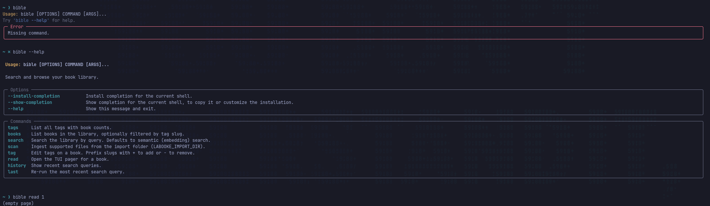

# bible CLI

Terminal client para o labooke. Acessa a biblioteca via HTTP (`LABOOKE_API_URL`,
padrão `http://localhost:8000`) — não conecta direto ao banco.



## Comandos

| Comando | O que faz |
|---|---|
| `bible books [--tag slug]` | Lista livros com ID, formato e tags |
| `bible tags` | Lista tags com contagem de livros |
| `bible search <query>` | Busca via LLM/ask (padrão) ou lexical (`--lexical`) |
| `bible read <id> [-p N]` | Abre o pager TUI na página N (padrão 1) |
| `bible read <id> --tdf` | Abre o PDF original no [tdf](https://github.com/itsjunetime/tdf) |
| `bible cache` | Menu para escolher quais PDFs baixados apagar do cache |
| `bible tag <id> +slug -slug` | Adiciona/remove tags de um livro |
| `bible scan` | Dispara ingestão da pasta de import |
| `bible history [-n N]` | Mostra últimas N queries |
| `bible last` | Re-executa a busca mais recente |

## Carregamento de páginas (lazy)

O pager carrega **somente a página atual** via HTTP. Nenhum pré-carregamento.
Ao pressionar `n` ou `p`, o pager faz um novo request antes de renderizar.

```
bible read 15       # abre na página 1
bible read 15 -p 42 # abre diretamente na página 42
```

Consequência: há um pequeno delay a cada troca de página (roundtrip HTTP +
extração do PDF). Para leitura linear isso é perceptível. Melhoria futura:
cachear a página seguinte em background após cada carregamento.

## Ler o PDF no tdf (opcional)

O pager mostra só o texto extraído. Para ver o PDF de verdade (imagens,
fórmulas, layout) num terminal com suporte a imagem (foot, kitty, ghostty),
use `--tdf`:

```
bible read 15 --tdf
```

O `tdf` é uma dependência externa opcional: precisa estar no `PATH`, e sem ele
o resto da CLI funciona normalmente. O fluxo é:

1. `GET /api/books/{id}/file` baixa o PDF (`_api_client.py`).
2. O arquivo fica em `$XDG_CACHE_HOME/labooke/books/<sha256>.pdf`
   (`~/.cache/...` por padrão), então a segunda abertura não baixa de novo
   (`_book_files.py`). Um `index.json` na mesma pasta guarda o título de
   cada arquivo.
3. `tdf <arquivo>` roda no terminal atual (`_pdf_viewer.py`).

Limitações: só funciona com livros PDF (EPUB/TXT saem com erro) e o `tdf` não
tem opção de página inicial, então `-p` é ignorado com aviso.

## Limpar o cache (`bible cache`)

`bible cache` abre um menu com os PDFs baixados, ordenados por título e com o
tamanho de cada um. Dá para apagar só alguns e manter os que você ainda lê.

| Tecla | Ação |
|---|---|
| `↑` / `↓` (ou `j` / `k`) | Move o cursor |
| `Espaço` | Marca / desmarca o livro do cursor |
| `a` | Marca todos os visíveis (respeita a busca) |
| `u` | Desmarca todos |
| `/` | Filtra por título (vazio mostra tudo de novo) |
| `Enter` | Apaga os marcados, depois de confirmar com `y` |
| `q` / `Esc` | Sai sem apagar nada |

Exemplo: para manter só um livro, marque todos com `a`, desmarque o que fica
com `Espaço` e confirme com `Enter`. A lógica do menu está em
`_cache_menu.py` (estado puro, testado sem terminal) e o desenho e a leitura
de teclas estão em `_cache_tui.py`.

## Teclas do pager

| Tecla | Ação |
|---|---|
| `←` / `→` (ou `<` / `>`) | Página anterior / próxima página |
| `↑` / `↓` | Rola o conteúdo da página atual |
| `n` / `p` | Próxima / anterior página |
| `j` / `k` | Scroll de linha |
| `Espaço` / `f` / `b` | Avança / avança / volta uma tela |
| `g` / `G` | Primeira / última página |
| `/` | Busca no texto da página |
| `:` | Ir para uma página pelo número |
| `q` | Sair |

Também é possível clicar na metade direita do terminal para avançar e na
metade esquerda para voltar. A roda do mouse rola o conteúdo da página.

O texto ocupa uma área central de até 88 colunas e somente as linhas que cabem
no terminal são exibidas. O cabeçalho e a barra de navegação permanecem fixos,
inclusive em capítulos longos de EPUB.

## Configuração

| Variável | Padrão | Descrição |
|---|---|---|
| `LABOOKE_API_URL` | `http://localhost:8000` | Endpoint da API |
| `LABOOKE_DATA_DIR` | `./data` | Diretório do histórico |

Exemplo para servidor remoto:
```bash
export LABOOKE_API_URL=http://meu-servidor:8000
bible books
```

## Histórico

Cada busca (`search` / `last`) é gravada em `$LABOOKE_DATA_DIR/bible_history.txt`.

`bible search` usa por padrão `GET /api/search?mode=hybrid`: KNN semântico
nos chunks dos livros + BM25, combinados por RRF. `--lexical` limita a busca
a título/filename. Os filtros de tag são aplicados no servidor. Esse fluxo
não requer LLM; a recomendação por descrições fica na interface web.

→ Ver [running.md](running.md) para como iniciar o servidor.
→ Ver [search.md](search.md) para detalhes dos modos de busca.
